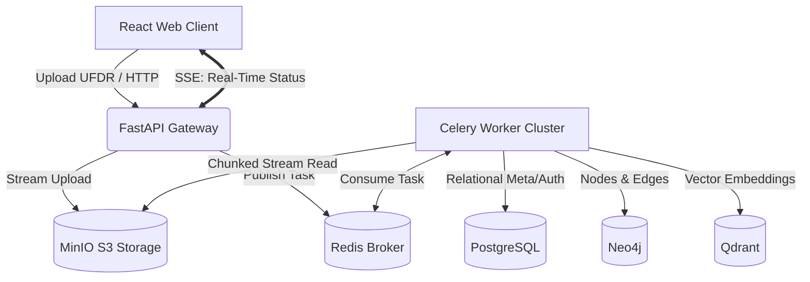

---

<div align="center">
  
#  AI-UFDR Analyzer

**Enterprise-Grade Automated Digital Forensics & AI Intelligence Pipeline**

[](https://github.com/yourusername/AI_UFDR_Analyzer/actions)
[](#)
[](#)
[](#)
[](#)


</div>

---

##  Executive Summary
AI-UFDR Analyzer is a distributed, multi-modal forensic data pipeline. It ingests massive mobile device extraction archives (UFDRs), bypasses memory constraints through iterative stream processing, and distributes the data across a **Polyglot Persistence** backend. 

By unifying relational data, graph topologies, and semantic vectors, the system enables investigators to run natural-language queries against complex communication networks, drastically reducing manual analysis time.

---

##  System Architecture & Polyglot Persistence

Forensic data presents heterogeneous access patterns. Forcing graph traversals or semantic searches into a relational schema results in exponential performance degradation. This architecture enforces strict separation of concerns across three specialized persistence layers:

1. **PostgreSQL (Source of Truth):** Enforces ACID guarantees for user authentication, role-based access, audit logs, and file cryptographic hashing.
2. **Neo4j (Graph Traversals):** Employs **Index-Free Adjacency** for O(1) multi-hop relationship queries (e.g., *Identify the shortest communication path between Suspect A and Suspect B*).
3. **Qdrant (Semantic Search):** Utilizes **HNSW (Hierarchical Navigable Small World)** indexing for sub-100ms vector similarity searches to detect context and intent (e.g., *Find hidden financial distress indicators*).

### Data Flow Topology



---

##  Core Engineering Achievements

* **Host-Level OOM Prevention via Iterative Parsing:** Bypassed the Linux OOM-killer on memory-constrained cloud environments (8GB RAM limit across 8 containers). Instead of loading multi-gigabyte XML manifests into RAM, the Celery worker employs chunked, iterative byte-streaming from MinIO.
* **Pre-Fork Subprocess Stabilization:** Debugged silent Celery worker crashes utilizing distributed **OpenTelemetry** traces. Identified standard async imports losing `sys.path` context during Celery's pre-fork cloning; stabilized by enforcing top-level module caching in the main thread prior to fork execution.
* **Dynamic Network Routing for CI/CD:** Hardcoded localhosts break cloud deployments. Engineered a dynamic API client leveraging `window.location.hostname` with strictly typed CORS middleware in FastAPI, ensuring seamless interoperability between local Docker networks and Microsoft Azure production environments.

---

##  Tech Stack

| Layer | Technologies |
| --- | --- |
| **Frontend** | React 18, TypeScript, Vite, Tailwind CSS, Server-Sent Events (SSE) |
| **Gateway & API** | FastAPI, Python 3.11, Pydantic, Uvicorn |
| **Asynchronous Compute** | Celery, Redis (Message Broker) |
| **Persistence (Databases)** | PostgreSQL (Relational), Neo4j (Graph), Qdrant (Vector) |
| **Object Storage** | MinIO (S3 Compatible) |
| **AI & NLP** | Cohere API, SentenceTransformers |
| **DevOps & Infra** | Docker, Docker Compose, GitHub Actions, Microsoft Azure |

---

##  Getting Started (Local Development)

### Prerequisites

* Docker Engine (v24.0+)
* Docker Compose V2
* Git

### 1. Clone & Configure

```bash
git clone [https://github.com/yourusername/AI_UFDR_Analyzer.git](https://github.com/yourusername/AI_UFDR_Analyzer.git)
cd AI_UFDR_Analyzer

```

Create a `.env` file in the root directory. Required environment variables:

```ini
# .env
# Database Credentials
POSTGRES_USER=admin
POSTGRES_PASSWORD=securepassword123
POSTGRES_DB=ufdr_db

# Neo4j Graph
NEO4J_USER=neo4j
NEO4J_PASSWORD=securepassword123

# JWT Authentication
JWT_SECRET_KEY=your_super_secret_jwt_signature_key
ALGORITHM=HS256
ACCESS_TOKEN_EXPIRE_MINUTES=1440

# AI/LLM Integration
COHERE_API_KEY=your_cohere_production_key

```

### 2. Ignite the Architecture

```bash
docker compose up --build -d

```

*The initial build will pull necessary database images and compile the React frontend. This may take 3-5 minutes depending on network bandwidth.*

### 3. Access the Interfaces

* **Web Client:** `http://localhost:5173`
* **FastAPI Swagger Docs:** `http://localhost:8000/docs`
* **MinIO Console:** `http://localhost:9001`
* **Neo4j Browser:** `http://localhost:7474`

---

##  CI/CD & Cloud Deployment

This repository implements Continuous Integration (CI) via GitHub Actions.

* On `git push` to `main`, the pipeline spins up an isolated `ubuntu-latest` runner.
* Executes a full `docker compose build` dry-run to verify dependency integrity, syntax, and container compilation.
* Designed for instantaneous CD transition to target environments (Azure/AWS) via SSH action configurations.

---

##  Future Architecture Roadmap

* [ ] **Multi-Tenant SaaS Boundary Enforcement:** Implement PostgreSQL Row-Level Security (RLS) linked to an `agency_id`, coupled with strict `[:OWNED_BY]` sub-graph constraints in Neo4j to enforce data isolation between independent law enforcement agencies.
* [ ] **Air-Gapped LLM Execution:** Deprecate external Cohere API dependencies in favor of a locally quantized Llama-3 model running via Ollama, ensuring zero forensic evidence transmission over public internet backbones.

---

##  License

This project is licensed under the MIT License - see the [LICENSE](https://www.google.com/search?q=LICENSE) file for details.

```

```